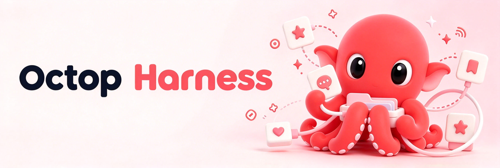

<div align="center">
  
  <h1>HappyClaw Harness</h1>
</div>

<p align="center">
  <strong>基于 Harness Engineering 理念工程化落地的生产级 Agent 运行时。</strong>
</p>

<p align="center">
  由 HappyClaw 维护（<a href="https://github.com/xkx121029">xkx121029</a>）。
</p>

<p align="center">
  <a href="https://www.python.org/downloads/"></a>
  <a href="https://github.com/xkx121029/happyclaw-harness/blob/main/LICENSE"></a>
  <a href="https://pypi.org/project/happyclaw-harness/"></a>
  <a href="https://github.com/astral-sh/ruff"></a>
</p>

<p align="center">
  <a href="#什么是-happyclaw-harness">什么是 HappyClaw Harness？</a> ·
  <a href="#为什么选择-happyclaw-harness">为什么选择 HappyClaw Harness？</a> ·
  <a href="#如何使用">如何使用</a> ·
  <a href="#文档">文档</a>
</p>

<p align="center">
  <a href="README.md">English</a> · <b>中文</b>
</p>

---


## 什么是 HappyClaw Harness？

**happyclaw-harness** 是一套基于 Harness Engineering 理论构建的生产级 Agent 运行时。它的核心，是对 [deepagents](https://github.com/langchain-ai/deepagents) 的一层轻量、面向生产的**封装与工程化实践**——基于 deepagents 优雅的 `create_deep_agent` 原语，在其之上包装生产环境真正需要的一切：多供应商模型路由、持久化记忆、浏览器/搜索工具、多 Agent 注册表、可插拔存储后端，以及一个终端 CLI。

> 💜 **致敬 deepagents。** happyclaw-harness 站在 [deepagents](https://github.com/langchain-ai/deepagents)（LangChain 团队出品）的肩膀上。我们的 `HarnessAgent` 最终会委托给 `deepagents.create_deep_agent`，其余——模型路由、后端、分层记忆、Agent 注册表、CLI 与 ACP——都是我们在其之上补充的工程能力。deepagents 提供了智能体的根基，Harness 为它安了一个能落地的"家"。


## 为什么选择 HappyClaw Harness？


|     | 特性                     | 说明                                                                                    |
| --- | ---------------------- | ------------------------------------------------------------------------------------- |
| 🧩  | **构建于 deepagents 之上** | 对 `deepagents.create_deep_agent` 的忠实、生产级封装 —— 致敬 deepagents 项目                       |
| 🔀  | **模型路由**               | `ChatModelFactory` 支持 OpenAI、Anthropic、AWS Bedrock，以及 17 个可编辑的供应商预设                   |
| 🧠  | **持久化记忆**              | 内置 [octop-memory](https://github.com/xkx121029/octop-memory) 中间件，支持 L0→L3 分层蒸馏 |
| 🛠️ | **丰富工具集**              | 开箱即用的浏览器自动化、网页搜索、文件操作、子 Agent 与 MCP 工具                                                |
| 🗂️ | **多 Agent 注册表**        | `AgentManager` 可在单个进程中托管多个彼此隔离的 Agent                                                 |
| 💾  | **可插拔后端**              | 本地目录、S3、COS 或 PostgreSQL 均可作为 Agent 工作区                                               |
| 🔌  | **ACP 集成**             | 提供 stdio ACP 服务，让 IDE / 终端 AI 直接驱动你的 Agent                                            |
| 🔒  | **安全内建**               | 工具护栏、文件系统权限与敏感信息脱敏                                                                    |
| 💬  | **Teams**              | 面向 Agent 间消息的 peer inbox                                                              |
| ⌨️  | **终端 CLI**             | 交互式对话、供应商 / 技能配置与 Agent 管理                                                            |


### 核心技术


| 层级           | 技术                                                                             |
| ------------ | ------------------------------------------------------------------------------ |
| **语言**       | Python 3.12+                                                                   |
| **Agent 内核** | [deepagents](https://github.com/langchain-ai/deepagents)（`create_deep_agent`） |
| **图运行时**     | LangGraph + SQLite 检查点                                                         |
| **模型路由**     | `ChatModelFactory`（OpenAI / Anthropic / Bedrock + 17 个预设）                      |
| **记忆**       | [octop-memory](https://github.com/xkx121029/octop-memory) 中间件           |
| **浏览器 / 搜索** | [octop-browser](https://github.com/xkx121029/octop-browser) + 网页搜索      |
| **工作区**      | `BackendWorkspace`：本地 / S3 / COS / PostgreSQL                                  |
| **ACP**      | agent-client-protocol                                                          |
| **构建 / 质量**  | hatchling · ruff · mypy · pytest                                               |


### 功能特性


#### Agent 运行时

- `HarnessAgentManager` —— 持有 Agent 注册表，可在单个进程中创建、列举与流式调用多个 Agent。
- `HarnessAgent` —— 提供 `call`、`stream`、`stream_events`、`aget_history` 与 `cancel`。
- 通过 LangGraph `AsyncSqliteSaver`（或 octop-memory 检查点）实现可恢复对话。


#### 模型路由与供应商

- `ChatModelFactory` 将模型名解析为对应的客户端。
- 一等供应商：**OpenAI**（含通过 `base_url` 兼容的 OpenAI 接口）、**Anthropic**、**AWS Bedrock**（可选 `[bedrock]` 扩展）。
- 17 个可编辑的供应商预设，含混元、Kimi、GLM、DeepSeek、MiniMax、Moonshot 等。


#### 分层记忆
- `MEMORY.md` 是强记忆，`USER.md` 是用户档案。每个会话首次加载全文快照，后续复用 checkpoint 中的快照；修改对新会话生效。结构化记忆开启时，这两份文档由用户手动维护，Agent 文件工具只读，「记住」走 `memory_save`。结构化记忆关闭时，Agent 用文件工具直接修改这两份文档，删除和移动仍被拦住。`manual_document_policy` 默认 `auto`，跟随这个开关；设为 `user` 时始终由用户维护，设为 `agent` 时即使记忆开启也允许 Agent 修改。规则由编译进系统提示的记忆段决定，并优先于工作区 `AGENTS.md` 里的旧写法。
- 工作区上下文的统一读取、session 快照、提示词格式和缓存断点复用 deepagents 原生 `MemoryMiddleware`。模板更新不覆盖已有用户文档。
- 普通记忆写入和自动晋升后，通过 `BackendWorkspace` 读取当前手动文档做核对，不刷新聊天快照。明确冲突以手动文档为准：旧 Atom 软停用，替代事实转 candidate，原证据保留；`memory_save` 会提示冲突或检查未完成。重复 Atom 保留，仅对已包含相同信息的会话快照抑制召回。语义不确定/模型不可用时不强制停用，宿主应展示待核对状态。文件工具防护不替代宿主的 shell/OS 权限策略。
- 用户说「记住」时，Agent 使用 `memory_save(content, topic, kind)` 直接保存到 octop-memory；当前对话模型选择 Fact、Preference、Decision 或 Task，不增加分类模型调用。省略仍为 Fact，类别与主题、实体类型分别处理。分类保存依赖配套且尚未发布的 memory `save(kind=...)` API；连接旧版时会明确提示升级，不静默降级为事实。应先发布并接入 memory；在支持该 API 的版本发布前，依赖声明保留现有正式版。历史事实不变，保存 Task 不创建定时提醒。`memory_search` / `memory_get` 用于补充历史召回。
  CI 分别验证已发布记忆库的兼容行为，以及固定到配套 memory PR 源码 revision 的分类契约。
- 自动召回在每轮首次调用模型前冻结，以带 source/role 标记的历史引用追加在当前用户原文和附件之后，让公共请求前缀尽可能延伸到完整用户输入。系统规则禁止把引用里的旧问题当成新请求；系统提示在各轮保持稳定，工具续跑和后续轮次复用历史快照，不刷新先前的召回。checkpoint 精确重放已有 v1 快照，聊天历史和记忆采集仍保留用户原文。
- 排查召回时，将 `happyclaw_harness.middleware.memory` 日志级别设为 DEBUG。`recall_inject` 会记录 `query_chars` 和 `query_sha256`：对实际传入 recall 的完整查询去除首尾空白后，以 UTF-8 计算 SHA-256，取前 16 位十六进制字符。按同样方法计算疑似查询的指纹即可检索、对账；长查询不会在计算前被截断，日志不输出查询原文。
- `HarnessAgentConfig(memory_recall_inject_enabled=False)` 可关闭新的自动召回，保留记忆工具和旧回合快照的精确重放。

- 对话经采集策略过滤后记录为 **L0 原始事件**，再异步蒸馏为 **L2 原子**（`AtomCard`）与 **L3 实体页**。系统运行报错不进入记忆，正常排障经验和用户明确记忆请求仍可保存。
- 模型重试耗尽后抛出异常；重试范围沿用 LangChain 默认判断，次数与退避参数保持原配置。调用方需处理 `call()` / 流式调用的异常；checkpoint 保留失败任务，不添加合成助手回复。宿主单独展示错误；团队自动失败通知设置 `configurable.octop_memory_capture_exclude=true`，避免诊断信息被采集为记忆。
- 定时 checkpoint 裁剪只用于 SQLite。PostgreSQL 的 checkpoint 表由多个 agent 和宿主共用。octop-memory 1.0.5 允许宿主在核实线程归属、暂停该线程在所有宿主上的执行、恢复和分叉后，离线裁剪该线程。
- 配套 Memory 提供 `acheckpoint_activity(thread_id)` 时，Harness 会在调用、流式执行、HITL 恢复、历史读取和状态更新的完整期间持有活动锁；取消时先等已接受的保存操作结束，拒绝晚到的保存任务；v3 流跨多次拉取保持同一作用域，直到结束或中止。宿主直接使用 `agent.graph` 时，应以 `async with agent.checkpoint_activity(thread_id)` 包住完整读写（包括分叉的源历史读取），也可调用 `happyclaw_harness.memory.checkpoint_activity(checkpointer, thread_id)`。共享这些线程的全部运行实例升级并参与协调后，宿主才能启用 PG 定时裁剪；旧 Memory 保持兼容，但不提供此协调保证。
- 由 octop-memory 中间件驱动，记忆随工作区一同迁移。


#### 宿主托管的记忆恢复

宿主可在暂停图执行准入后，使用 `MemoryMiddleware.pause_background(timeout=120)` 作为上下文管理器。它只排空该中间件的采集、抽取与维护 worker，暂停期间不接受新的后台任务，并在退出或超时后恢复准入。关闭并重建记忆运行时时应全程持有它；其他 expert 不受影响。

记忆运行时的常规关闭会立即停止接受后台任务并直接返回。运行时保留对共享数据库的持有，直到所有已接受的 worker 结束，包括在配置变更中被替换的中间件留下的 worker。没有待处理任务时立即释放资源。`MemoryMiddleware.shutdown(on_idle=callback)` 让资源持有者收到同样的完成信号：回调在工作线程锁之外执行一次，空闲时立即执行，否则在最后一个 worker 的线程上执行。关闭不会让进程保持存活；需要等待 worker 的宿主应在退出前排空它们。

#### 工具与技能

- 内置工具：浏览器（octop-browser）、网页搜索、文件、用于「仅回答」式人工决策的 `ask_user_question`、可选的供应商中立图像 / 视频生成、子 Agent 与 MCP 工具。无人值守的 Agent 可设置 `ask_user_enabled=False`。
- 技能来自 deepagents 的 skills 中间件，可通过 CLI 按 Agent 管理。
- 可选的 `system_files_path`（如 `.octop`）会把技能、会话、`.env` 与 sqlite 收进工作区下的子目录，而人格 markdown 仍留在根目录。

使用 Volcengine Ark 可启用供应商中立的 `generate_image` 与 `generate_video` 工具：

```python
from happyclaw_harness import HarnessAgentConfig, MediaGenerationConfig

config = HarnessAgentConfig(
    # ...providers/default_model...
    media_generation=MediaGenerationConfig(api_key_env="ARK_API_KEY"),
)
```

生成的文件存放在 Agent 工作区的 `generated/images/` 与 `generated/videos/` 下。这些工具默认延迟加载，只有在需要时才通过配置的工具搜索策略变为可见。供应商侧的预期故障会返回结构化、模型可见的错误封装并附带重试指引，而不是终止 Agent 流。

如需让图像与视频走不同路由，可配置具名供应商。内置适配器覆盖 Volcengine Ark（Seedream/Seedance）、阿里云百炼（Wan）与 MiniMax（image-01/H3）：

```python
from happyclaw_harness import HarnessAgentConfig, MediaGenerationConfig, MediaProviderConfig

config = HarnessAgentConfig(
    # ...providers/default_model...
    media_generation=MediaGenerationConfig(
        providers=[
            MediaProviderConfig(
                id="ark-images",
                provider="volcengine",
                api_key_env="ARK_API_KEY",
                video_enabled=False,
            ),
            MediaProviderConfig(
                id="minimax-videos",
                provider="minimax",
                api_key_env="MINIMAX_API_KEY",
                image_enabled=False,
            ),
        ],
        default_image_provider="ark-images",
        default_video_provider="minimax-videos",
    ),
)
```

高级宿主可以把 `MediaManager` 注入 `build_media_generation_tools`，并注册一个受限的自定义适配器，而无需向声明式配置添加任意协议或鉴权字段。


#### 多 Agent 与协作

- 通过 `AgentManager` + `registry` 在单进程内托管多个隔离 Agent。
- **Teams** peer inbox 用于 Agent 间消息互通。
- **ACP** stdio 服务，供外部 IDE / 终端 AI 调用你的 Agent。


#### 安全

- `SecurityPolicy` 提供工具护栏、文件系统权限（`FilesystemPermission`）与敏感信息脱敏中间件。
- 敏感信息检测覆盖 API Key、中国大陆手机号（常见 13-19 号段，可带 `+86` / `0086`）及省份代码、1900-2099 出生日期和校验位均有效的 18 位居民身份证号，沿用 `pii_strategy` 与 `pii_surfaces`；不识别旧版 15 位身份证号或其他国家的号码。


#### CLI

`happyclaw-harness` 提供：`init`、`chat`、`agent`、`config`（如 `config provider add`）、`skill`、`update`。

## 如何使用

当前版本：**1.0.11**。更新内容见[发布说明](CHANGELOG.md)。


### 环境要求

- **Python 3.12+**
- 一个模型供应商的 API Key（OpenAI / Anthropic / Bedrock / 兼容接口）


### 1. 安装

```bash
# 核心 SDK —— Agent 运行时、模型路由、工具、技能、后端
pip install happyclaw-harness

# 附带终端 CLI —— 交互式对话、配置、技能管理
pip install happyclaw-harness[cli]

# 多个 extras —— 同一对方括号内用逗号分隔（建议给 shell 加引号）：
pip install 'happyclaw-harness[object-storage,desktop]'
pip install 'happyclaw-harness[cli,all]'
```

按需安装的 optional extras（缺包时在用到对应功能时才会报错并提示安装命令）：


| Extra             | 用途                                                       |
| ----------------- | -------------------------------------------------------- |
| `cli`             | 终端 CLI（`happyclaw-harness`）                                  |
| `bedrock`         | AWS Bedrock 供应商                                          |
| `object-storage`  | 腾讯云 COS + 阿里云 OSS + 华为云 OBS SDK                          |
| `desktop`         | 桌面截图 / 键鼠（`mss`、`pynput`、`pillow`）                       |
| `web-search-all`  | 全部网页搜索后端（Tavily / Brave / Google）                        |
| `remote-backends` | Postgres 工作区后端（`psycopg`）。S3 使用内置 boto3 后端。 |
| `observability`   | Langfuse                                                 |
| `acp`             | ACP agent runner                                         |
| `all`             | 上面全部**库功能** extras（**不含** `cli`；两者都要则用 `[cli,all]`）      |


### 2. 初始化与配置

```bash
happyclaw-harness init
happyclaw-harness config provider add   # 选择供应商并粘贴你的 Key
```


### 3. 对话

```bash
happyclaw-harness chat
```


### 编程式使用

```python
from happyclaw_harness import HarnessAgentManager, HarnessAgentConfig, ProviderConfig, ChatRequest

manager = HarnessAgentManager()
agent: HarnessAgentConfig = manager.create_agent(
    name="assistant",
    provider=ProviderConfig(name="openai", api_key="sk-..."),
    model="gpt-4o",
)
request = ChatRequest(message="用一段话总结 Harness 理论。")
async for chunk in agent.stream(request):
    print(chunk.delta, end="")
```


### 渐进式工具加载

体量大、使用频率低的工具集可以先隐藏起来，等模型需要时再加载。默认的 `client` 模式注册一个普通的 `tool_search` 函数，因此任何支持函数调用的 Chat Completions 兼容模型都能使用。未加载的工具仍以其真实名称和简短描述可见，参数 schema 则被替换成一个轻量引用。搜索结果会追加到对话中，匹配到的完整 schema 在模型下一步时替换这些引用，已加载的集合在线程内持续有效。被选中的工具仍以真实名称、经由常规的 DeepAgents ToolNode、安全护栏与中断策略调用。

```python
from happyclaw_harness import HarnessAgentConfig, ProviderConfig

provider = ProviderConfig(
    id="openai",
    base_url="https://openai-compatible.example/v1",
    api_key="sk-...",
    protocol="openai",
)

config = HarnessAgentConfig(
    providers=[provider],
    default_model="openai/your-function-calling-model",
    tools=[generate_image, generate_video, generate_3d_asset],
    deferred_tools=frozenset(
        {"generate_image", "generate_video", "generate_3d_asset"},
    ),
    defer_mcp_tools=True,
    tool_search_mode="client",  # default; no Responses API required
)
```

设为 `tool_search_mode="native"` 可使用 OpenAI Responses 托管的 `tool_search`，或 Anthropic 托管的 `defer_loading` / `tool_reference`。原生模式还额外要求 `ModelConfig.native_tool_search=True`；不支持的路由模型会退回到配置的 `tool_search_fallback`。设为 `eager` 即可关闭渐进式加载。

对于 OpenAI 兼容供应商，每个模型可以把 `api_mode` 设为 `"chat_completions"`（默认）或 `"responses"`。无论官方端点还是兼容端点，这个选择都必须显式指定。原生 OpenAI 工具搜索依赖 Responses。使用 Responses 的模型还可以选择开启 `api_fallback="chat_completions"`。该回退默认关闭，只在端点或模型明确不支持、且尚未产生任何流式输出时使用；它不适用于原生工具搜索或其他仅 Responses 支持的请求特性，也不会掩盖鉴权、限流、超时或服务端错误。

HITL 的 `resume_hitl(thread_id, decisions)` 会在嵌套审批之间保留被暂停流的用户、工具选择及其他请求配置。宿主必须对发起恢复的调用方进行授权。该上下文只存在于进程内、按线程隔离，并在恢复的流结束或 Agent 关闭时释放。

### 定时 SQLite checkpoint 备份

checkpoint 裁剪本身、PostgreSQL 共享表现状以及 `acheckpoint_activity(thread_id)` 的活动锁协调，已在[分层记忆](#分层记忆)章节说明；这里补充裁剪前的自动备份。

开启 checkpoint 定时裁剪后，`HAPPYCLAW_CHECKPOINT_BACKUP_BEFORE_PRUNE` 默认为 `first`。第一次出现可裁剪 checkpoint 的清理会尝试写入 `memory.sqlite.pre-prune.bak`。如果数据库连同 WAL 再加 10% 余量放不下，或者复制失败，维护任务会给出警告并继续裁剪。`memory.sqlite.pre-prune.done` 会记录这次尝试及其结果，使后续清理不再重试。删除该标记后，下次存在可裁剪 checkpoint 时会再尝试一次。

将该模式设为 `always`，会在每次清理前替换备份，并在备份无法写入时推迟 checkpoint 裁剪。旧取值 `1`、`true`、`on`、`yes` 同样选中 `always`。设为 `off`（或 `0`、`false`、`no`）可关闭备份。维护任务默认在 7 天后让备份过期。设置 `HAPPYCLAW_CHECKPOINT_BACKUP_KEEP_DAYS=0` 可永久保留。过期会保留标记本身。


## 文档

- [什么是 HappyClaw Harness？](#什么是-happyclaw-harness)
- [为什么选择 HappyClaw Harness？](#为什么选择-happyclaw-harness)
- [如何使用](#如何使用)
- [文档](#文档)


### CLI 参考


| 命令                     | 说明                                |
| ---------------------- | --------------------------------- |
| `happyclaw-harness init`   | 初始化工作区与配置                         |
| `happyclaw-harness chat`   | 与 Agent 交互式对话                     |
| `happyclaw-harness agent`  | 创建、列举与管理 Agent                    |
| `happyclaw-harness config` | 供应商 / 模型配置（`config provider add`） |
| `happyclaw-harness skill`  | 按 Agent 启用 / 停用技能                 |
| `happyclaw-harness update` | 检查并安装更新                           |


### 项目结构

```
src/happyclaw_harness/
  agent.py          对 deepagents.create_deep_agent 的封装门面
  manager.py        AgentManager —— 多 Agent 注册表
  config/           配置、供应商与模型预设
  llm/factory.py    ChatModelFactory —— 模型路由
  backends/         BackendWorkspace —— 本地 / S3 / COS / Postgres
  builtin/          工具 + 技能 + 种子文件
  middleware/       model_router, skill_filter, tool_guard, memory, pii, ...
  memory/           MemoryRuntime（octop-memory 封装）
  protocols/        langgraph / openai / mcp 流式协议
  acp/              ACP stdio 服务
  teams/            peer inbox
  cli/              终端 CLI
```


### 开发

**环境要求：** Python 3.12+、[uv](https://docs.astral.sh/uv/)

```bash
make install          # pip install -e ".[cli,dev]"
make all              # 格式化 + 类型检查 + 测试
```


## 🤝 贡献

1. Fork 本仓库
2. 创建特性分支（`git checkout -b feature/amazing-feature`）
3. 提交前运行 `make all`
4. 向 `main` 发起 Pull Request

模块边界与编码规范见 [AGENTS.md](AGENTS.md)。

分支、PR 与发版流程见 [CONTRIBUTING.md](CONTRIBUTING.md)（`release/*` → `main` 合并后自动发布到 PyPI）。

## 🔗 相关项目


| 项目                                                                 | 说明                               |
| ------------------------------------------------------------------ | -------------------------------- |
| [deepagents](https://github.com/langchain-ai/deepagents)           | Harness Agent 所封装的智能体根基 —— ❤️ 致敬 |
| [octop-memory](https://github.com/xkx121029/octop-memory)   | 支撑分层记忆的记忆系统                      |
| [octop-browser](https://github.com/xkx121029/octop-browser) | Agent 使用的 CDP 浏览器自动化             |
| [octop-gateway](https://github.com/xkx121029/octop-gateway) | 多平台 IM 通道桥接                      |
| [HappyClaw](https://github.com/xkx121029/HappyClaw)                 | 组合 HappyClaw Harness 技术栈的自托管助手    |


## 🙏 致谢与来源

HappyClaw Harness 基于 Octop Harness（`TencentCloud/octop-harness`）开发，版权归 Octop 所有（Copyright (c) 2026 Octop），以 MIT 许可证发布。HappyClaw 维护一个独立分支，详见 [ATTRIBUTION.md](ATTRIBUTION.md)。

## 📄 许可证

本项目基于 [MIT 许可证](LICENSE) 开源。

## ✨ 贡献者

感谢所有贡献者：

<a href="https://github.com/xkx121029/happyclaw-harness/graphs/contributors">
  
</a>

### 通道插件

`kind: channel` 的 manifest 可以通过
`ctx.channel("acme", AcmeChannel, label="Acme IM", fields=[...])` 注册一个通道类。
该类必须继承宿主网关的 `BaseChannel`，不接受工厂函数。Harness 只存储元数据，
不会导入网关。宿主需要在构造持久化通道之前注册好实现。插件 ID 拥有自己的
kind：更新会替换同一个插件，所有者冲突会被拒绝。宿主在替换或移除注册前，必须先
停止受影响的在线实例。仅安装本库，不会为一个尚未实现桥接的宿主添加通道。

## 持久化 MCP 会话

当工具需要在多次调用之间保持状态（例如一份设计简报）时，使用 `ManagedMCPClient`。
该客户端在单个任务中持有自己的传输层，并把并发调用方串行化。
它返回 MCP SDK 的原始结果，包括结构化内容和错误。

```python
from happyclaw_harness import ManagedMCPClient

async with ManagedMCPClient({"transport": "stdio", "command": "my-mcp", "args": []}) as client:
    definitions = await client.get_tools()
    result = await client.call_tool("collect", {"title": "Demo"})
    resources = await client.list_resources()
    resource = await client.read_resource("example://design")
```

也支持显式调用 `await client.aclose()`。已关闭或已断开的客户端必须替换；
写入永远不会自动重试。默认的 MCP 工具加载仍然是无状态的。
